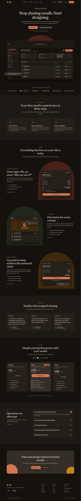
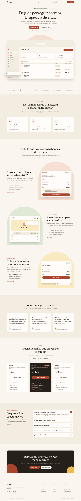

<a href="https://saas-kiln.netlify.app"></a>

# Kiln — SaaS landing page, from Figma to code

The landing page of Kiln, a client portal for small design studios that brings proposals, approvals, files and invoices into one branded space. Built from its Figma file with **Astro 7, Tailwind CSS 4 and TypeScript**, with GSAP for the animations.

**[Live site ↗](https://saas-kiln.netlify.app)** · **[Figma file](https://www.figma.com/design/alzYXnsPzEWTUOX02Xn3Mf/kiln)** · Built by [Javier Piedra](https://jpiedra.com/en/)

> Concept project, designed and built end to end: Figma file, code and deployment.

| Light, Spanish | Tablet | Mobile, dark |
| --- | --- | --- |
|  |  |  |

## Overview

The hard part of a Figma-to-code job isn't drawing the page, it's keeping design and code in sync after handover. In Kiln, every colour, spacing, radius, shadow, text style **and piece of copy** comes from the Figma variables through a script that can be run again at any time. If the design changes, the build tells you what no longer fits.

- **Languages:** Spanish at `/` and English at `/en/`.
- **Theme:** light/dark, following the system, with a manual switch that is remembered.
- **Hosting:** static site on Netlify (no server or adapter).

## Highlights

- **Design tokens straight from Figma**, exported with a local plugin and versioned in the repo: 123 primitives, 63 theme variables (light/dark), 42 layout variables (3 modes), 265 texts (ES/EN), 20 text styles and 4 effect styles.
- **Fluid responsive.** The Figma frames are 390, 834 and 1440 px wide. Every spacing and type token is interpolated between those widths with `clamp()` in `rem`: exact at 390, 834 and 1440, continuous in between, and it respects browser zoom.
- **Components = Figma components.** Same names and variants (`Button variant/size`, `Badge tone`, `Plan card featured`…); Hover / Focus / Pressed / Disabled map to `hover:` / `focus-visible:` / `active:` / `disabled:` with the same tokens Figma uses.
- **Mockups in HTML, not images.** They change with the theme and the language and stay sharp on any screen.
- **Interactions:** monthly/annual billing toggle that updates every plan's price, accessible FAQ accordion and mobile menu, and subtle entrance animations.

## Tech stack and decisions

| Area | Choice |
|---|---|
| Framework | Astro 7, static output, TypeScript |
| Styling | Tailwind CSS 4 with a theme generated from Figma (default scales switched off) |
| Animation | GSAP + ScrollTrigger, lazy-loaded |
| i18n | Copy from the Figma "Language" collection, `hreflang`, canonical and sitemap with alternates |
| Fonts | Fraunces and Instrument Sans, self-hosted via Astro's Fonts API and subset |
| Quality | Playwright + axe-core, pixel diff against Figma, Lighthouse CI, responsive sweep |
| Hosting | Netlify |

- **No hand-written values.** `bg-red-500`, `p-4` or `text-sm` don't exist in this project, and `npm run lint:tokens` fails the build if `src/` contains a literal colour, an arbitrary value without a token (`p-[13px]`) or a px/rem measure in spacing properties.
- **Names aren't invented.** They come from the code syntax already set in Figma (`bg/canvas` → `var(--bg-canvas)`, `hero/title` → `t('hero.title')`), so what you see in Dev Mode is what's in the code.
- **Fonts on a diet.** `scripts/build-fonts.ts` fixes the axes Figma uses (`SOFT 0`, `WONK 1`, width 100) and keeps only Latin characters: Fraunces drops from 118 KB to 56 KB. Metric-adjusted fallbacks keep CLS at 0.

## Accessibility and performance

| Check | Result |
|---|---|
| Lighthouse mobile (`/` and `/en/`) | Performance 99 · Accessibility 100 · Best practices 100 · SEO 100 · **CLS 0** · TBT 0–10 ms |
| axe-core (WCAG 2.2 AA + best practices) | 0 violations across ES/EN × light/dark × 390/834/1440 and with the menu open |
| Keyboard and interaction tests | 28/28 (no theme flash, language switch keeps the anchor, pricing, FAQ, focus trap and Escape, skip link, reduced motion) |
| Fidelity to Figma | 49/51 sections with the same height as Figma and < 2.5 % different pixels. The other 2 are the mobile footer (see below) |
| Responsive sweep | No horizontal scroll at 16 widths (320–2560 px) in both languages |

- Animations only use `transform` and `opacity`, so they never shift the layout. The hero heading is never hidden, so it doesn't delay LCP.
- With `prefers-reduced-motion: reduce`, GSAP isn't downloaded and all content is visible from the start. Without JavaScript, everything is visible too.
- Every `npm run tokens` checks the main text/background pairs in both themes and warns if any falls below WCAG AA.
- For screen readers, each mockup is an image (`role="img"`) with a description.

## Getting started

Requires Node 22 (see `.nvmrc`).

```bash
npm install
npm run dev        # http://localhost:4321
npm run build      # checks tokens + types and outputs dist/
npm run preview    # serves dist/
```

| Script | What it does |
| --- | --- |
| `npm run tokens` | Generates CSS, the Tailwind theme and translations from `tokens/figma.json` |
| `npm run check` | `tokens:check` (generated files are up to date) + `lint:tokens` (nothing hand-written) + `astro check` |
| `npm run build` | `check` + `astro build`. This is what Netlify runs |
| `npm test` | Playwright tests: accessibility with axe and keyboard interactions (requires `build`) |
| `npm run visual` | Compares each section with its Figma capture and writes `tests/visual/output/report.md` |
| `npm run sweep` | Checks there's no horizontal scroll at 16 widths, from 320 to 2560 px |
| `npm run lighthouse` | Mobile Lighthouse with assertions: ≥ 95 in all four categories and CLS = 0 |
| `npm run fonts` | Regenerates the optimised fonts (only if the families change) |

The first time you run the tests: `npx playwright install chromium`.

---

## From Figma to tokens

```
Figma (variables + styles)
   │  figma/export-tokens.js   ← local plugin or Figma MCP
   ▼
tokens/figma.json              ← versioned copy: the source of truth in the repo
   │  npm run tokens  (scripts/build-tokens.ts)
   ▼
src/styles/tokens.css          CSS variables: primitives, light/dark theme, fluid layout
src/styles/tailwind.theme.css  Tailwind theme: only token-based utilities exist
src/i18n/figma/{es,en}.json    the 265 texts of the Language collection
```

### 1. Export from Figma

The Figma Variables REST API is Enterprise-only, so the export runs inside Figma with `figma/export-tokens.js`. The same code works two ways:

- **Local plugin (no dependencies):** Figma desktop → _Plugins → Development → Import plugin from manifest…_ → choose `figma/manifest.json`. Running "Kiln · Export tokens" shows the JSON with a download button: save it as `tokens/figma.json`.
- **Via MCP (Claude Code):** run the script with `use_figma` and save the response to `tokens/figma.json`.

Then:

```bash
npm run tokens      # regenerates the files
npm run build       # fails if anything in the code doesn't fit the new tokens
```

The exporter saves the four collections with their modes, aliases, scopes and each variable's code syntax, plus the 20 text styles and the 4 effect styles.

### 2. What `build-tokens` generates

| Figma collection | CSS output | In Tailwind |
| --- | --- | --- |
| **Primitives** (123) | `--clay-600`, `--space-16`, `--font-size-13`… | No primitive colours exposed. `p-16`, `gap-24`… (= `space/16`, `space/24`); `rounded-12`; `font-display` |
| **Theme** (63, Light/Dark) | Light theme on `:root` and dark theme with `[data-theme=dark]`, plus `prefers-color-scheme` as a no-JS fallback | Class names match Figma: `bg-canvas`, `text-secondary`, `border-default`, `icon-brand`, `bg-status-success`… |
| **Layout** (42, 3 modes) | **Fluid** spacing and type with `clamp()` | `px-page`, `py-section-padding`, `gap-section-gap`, `gap-grid`, `p-card`, `max-w-header`, `w-plan`… |
| **Language** (265, ES/EN) | `src/i18n/figma/es.json` and `en.json` | `t('pricing.studio.price-annual')` |
| Text styles (20) | — | `type-display`, `type-h2`, `type-body-lg`, `type-label-md`, `type-overline`, `type-app-body`… |
| Effect styles (4) | Shadows as `--effect-shadow-*` (they change with the theme) and the `Focus/Ring` halo | `shadow-sm`, `shadow-md`, `shadow-lg` |

- **Max widths** (`hero-text-width`, `plan-width`…) aren't interpolated: when they fill the frame's content in Figma they become `100%`.
- **Breakpoints** mark where the structure changes (for example, plans go from column to row); values stay fluid. They're the only setting not taken from Figma, in `CONFIG.breakpoints` of `scripts/build-tokens.ts`: `md` (768 px, tablet) and `lg` (1200 px, desktop).
- **Layout booleans** become utilities with the same name: `visible-desktop`, `visible-tablet-up`, `visible-tablet-down` and `visible-mobile`.
- The only documented exception is `src/styles/dimensions.css`: fixed measurements of mockup pieces that aren't variables in Figma, such as the 220 px sidebar or the CTA arcs.

## From tokens to code

```
src/
├─ components/
│  ├─ ui/         Button, TextLink, Badge, Avatar, ListItem, IconButton, Icon, Logo, ClientLogo, SectionHeader
│  ├─ controls/   ThemeSwitch, LanguageSwitcher, BillingToggle, FaqItem
│  ├─ mockups/    AppWindow, StatCard, TableRow, SidebarItem, Toast, MockupProposal, MockupFiles, MockupInvoice
│  ├─ sections/   Navbar, Hero, Logos, HowItWorks, Features, Testimonials, Pricing, Faq, Cta, Footer
│  └─ Landing.astro
├─ layouts/Base.astro   <head>: flash-free theme, hreflang, canonical, fonts
├─ i18n/                Figma texts (generated) + site/{es,en}.json (accessibility, 404)
├─ scripts/             theme, language, menu, pricing, FAQ and animations (GSAP)
├─ styles/              global.css + tokens.css and tailwind.theme.css (generated) + dimensions.css
├─ assets/              SVG icons and logos exported from Figma, and optimised fonts
└─ pages/               index.astro (ES), en/index.astro (EN), 404.astro, robots.txt.ts
```

- **Icons.** Figma SVGs are stored unmodified and inlined so they inherit `currentColor`; they work in both themes.
- **Copy.** All copy comes from the Figma Language collection. Anything not in Figma lives in `src/i18n/site/`: accessibility labels, screen reader messages and the 404 page. TypeScript checks that English has every Spanish key.

### Interactions

| Piece | Implementation |
| --- | --- |
| Theme | A script in `<head>` sets `data-theme` before painting (saved preference or the system's). The switch stores it in `localStorage` and, with no choice made, follows system changes |
| Language | `/` and `/en/` routes with `hreflang` (es, en, x-default), canonical and sitemap with alternates. The switcher uses real links and keeps the anchor (`/#pricing` → `/en/#pricing`) |
| Monthly/annual | `role="switch"`: swaps `price-monthly` ↔ `price-annual` and announces it with `aria-live`. The labels are clickable too |
| FAQ | Native `<details>/<summary>` (works without JS and with the browser's find); GSAP animates the height |
| Mobile menu | Modal `<dialog>` with an explicit focus trap. Closes with Escape, the close button or a click on the backdrop, and returns focus to the button that opened it |
| Animations | GSAP + ScrollTrigger, lazy-loaded: hero entrance, scroll reveals, mockups (arc, card, toasts and gentle parallax), KPI counter, CTA arcs, price change, menu and FAQ |

`npm run visual` saves an image with Figma, the code and the differences for each section in `tests/visual/output/<variant>/<section>.png`. The Figma reference captures are in `tests/visual/reference/`.

## Intentional differences from Figma

- **Contrast.** The primitive `color/sand/550` was added in Figma and `text/tertiary` (light) and `bg/toggle-off` (and its hover) were reassigned to meet WCAG AA. Focus uses a solid `border/focus` outline on top of the `Focus/Ring` halo, because the halo alone (at 32 %) doesn't reach 3:1.
- **Mobile footer.** In the 390 px frame the "Resources" column is clipped by the container's `overflow`. In code the columns wrap so no content is lost (+180 px of height).
- **Mockup invoice.** In Figma its shadow is clipped by the container. In code it's shown in full.
- **Hero browser bar.** It's 124 px tall because in Figma it has two 100 px spacers. Kept as designed; if it's a design mistake, fix the frame in Figma and change `--spacing-chrome-spacer` in `dimensions.css`.
- **Language list.** Figma defines the button ("Opens the ES/EN menu") but not the dropdown. It was designed with existing tokens (`bg-surface-raised`, `border-default`, `shadow-md`, `radius-12`).

## Deploying to Netlify

1. Push the repository to GitHub.
2. In Netlify: _Add new site → Import an existing project_ → choose the repository. `netlify.toml` already defines the command (`npm run build`), the folder (`dist`), Node 22, caching for `/_astro/*` and security headers.
3. Environment variables (optional):
   - `SITE_URL`: final domain for canonical, hreflang and sitemap. Without it, the Netlify URL is used.
   - `PUBLIC_APP_URL`: app address for "Log in" and "Start free". Defaults to `https://app.kiln.app`.

The other link targets (demo, sales, footer) are in `src/config/site.ts`.

---

Designed and built by **[Javier Piedra](https://jpiedra.com/en/)** — WordPress, 3D web and accessible front-ends. Need your Figma design built like this? [Get in touch](mailto:javierpiedraiglesias@gmail.com).
